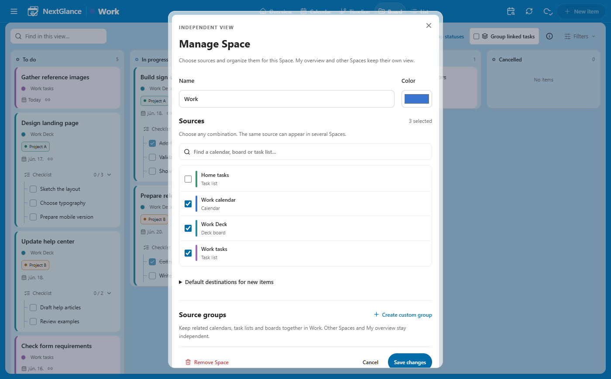
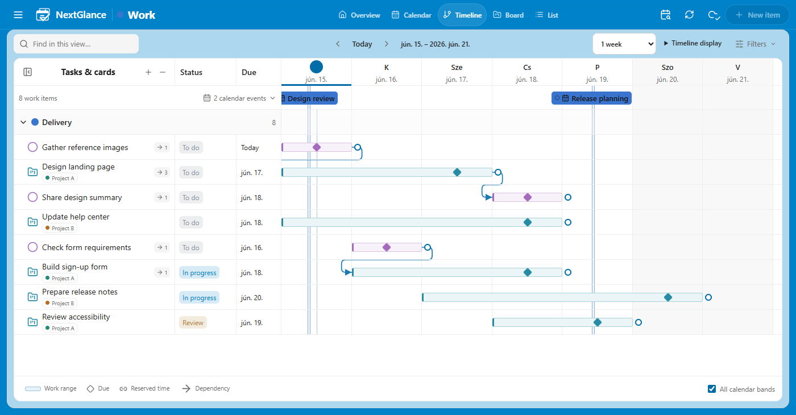
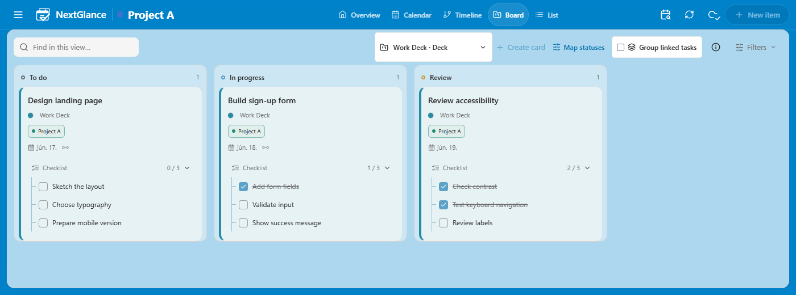
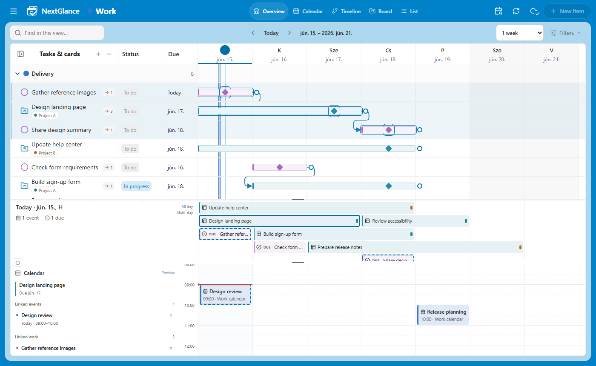
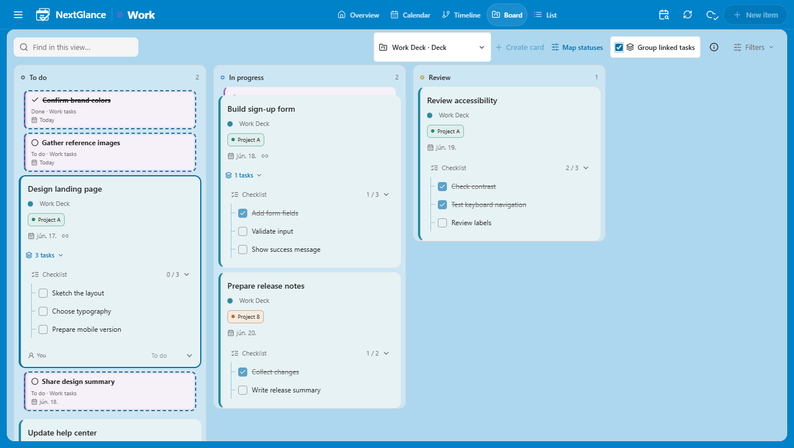

# NextGlance: a practical guide

Updated for **0.6.17**, 17 November 2026. Screenshots show the actual interface with generated, fictional test data—no personal accounts or calendars.

## Start here

On **Windows or Android**, open **Settings & connection** and connect your Nextcloud account. Android offers **Continue with Nextcloud Files** or browser sign-in. The **Nextcloud Web app** uses your existing Nextcloud login and needs a connection; there is no separate sign-in or offline mode.

**My overview** brings your accessible sources together. Its filters still apply. If an item seems missing, check source visibility, assignments and status filters. To organize this overview without making a Space, use **My overview → ⋯ → Group sources**.

## 1. Space: choose which sources belong together

Open navigation, choose **+ beside Spaces**, name the Space **Work**, and select Work tasks, Work Deck and Work calendar.

Work now contains those sources across all five pages. Home tasks remain in My overview. Nothing is copied or moved in Nextcloud. Use Work’s **⋯ menu** to change sources or **Delete Space**; deleting a Space keeps the original items.

## 2. Source group: combine related sources under one heading

Within Work, open **Group sources**, create **Delivery**, and assign the three Work sources.

Timeline and Overview now group their rows under Delivery. Select Delivery in navigation to focus on those sources. Each item keeps its source color and permissions. This grouping affects Work only—not another Space or My overview. **Narrow by tags** can include just part of a source.

In these examples, each task takes one day; Deck cards represent the larger assignment. The Timeline connectors show task-to-card dependencies. Use **Dependencies → Link task** on a card to connect your own tasks.

## 3. Project: focus on a particular outcome

Choose **Add project** from Work’s menu. Name it **Project A**, select its sources and choose its native project tag under **Narrow by tags**.

Project A and Project B can share a calendar or Deck board while showing different tagged items, including future matches. Several selected tags mean **any** matching tag. You can also add individual items from their details. Projects remain inside their Space and can sit within a source group.

## Overview: work and bookings together

**Overview** puts task/card dates above calendar bookings on the same date axis. Select or hover an item to highlight linked work across the panes. Here, one-day tasks support a longer Deck card, and its linked review is an actual calendar booking. Work dates and booked time remain separate.

## Board: keep linked tasks with their card

Enable **Group linked tasks** in the Board toolbar (or its menu on smaller screens). Tasks the card waits for appear above it, such as **Gather reference images**; tasks that need the card appear below it, such as **Share design summary**.

Tasks peek out from behind the card until you hover or select it; the stack then expands so you can read them. Completed tasks are crossed out. Completed Deck cards stay visible; archived cards are hidden. Completed tasks linked to a visible card remain visible even when other completed tasks are hidden. On touch, hold the card before dragging it—the card follows your finger and highlights its destination.

## Everyday planning

- **Choose a page:** Overview combines a work timeline and calendar; Calendar offers **Day / Week / Month**; Timeline shows work ranges and dependencies; Board uses status columns; List gives a compact item list. On phones, tap the current page name to switch.
- **Unscheduled work:** open **Not scheduled** on Overview, Calendar or Timeline. Hide the sidebar with its header button or drag its left edge to resize. On Timeline, **Hide unscheduled items in timeline** controls chart rows independently of the sidebar. Calendar and Overview’s dated panes already omit undated work.
- **Dates and bookings:** **Edit dates** changes a task/card’s work range. On Windows/Android, **Schedule in calendar** creates a linked booking with an editable title, description, location and reminder (15 minutes before by default). On Web, create the event first, then **Link existing event**. Moving a booking does not automatically move the work deadline.
- **Events:** open an event to edit its details or use **Delete event**. Supported invitations offer attendee controls or Accept/Tentative/Decline. Restricted recurring/delegated edits open in Nextcloud.
- **Dependencies:** **Waits for** lists prerequisites; **Needed by** lists dependent work. In a Deck card, **Link task**, **Create task** and **From checklist** connect native tasks. Checklist conversion reuses existing matches and saved retries; the original checklist and task completion remain separate.
- **Statuses and filters:** **Map statuses** customizes the current Space; **Use default** restores inheritance. **Filters → Unified statuses** limits the current page. Each page has independent filters, synchronized across devices—including My overview.
- **Find linked work:** use **Jump to** beside a linked task or event. Board/List offer Calendar or Timeline as the destination.

## Sync and troubleshooting

Spaces, groups, projects, status maps, custom ordering and saved filters sync through Nextcloud. Open pages, dates, scroll positions and panel sizes stay local. Android’s **Background sync** settings control intervals and Wi-Fi preference; Android determines when background jobs actually run.

Tap the **cloud icon** for source/planner status and retry options. For a slow refresh, use **Settings & connection → Performance diagnostics → Start recording**, reproduce it, then stop and **Copy log** or **Save log**. Diagnostics contain timings and counts, not item content.

For Web installation, use the [manual deployment guide](../web/DEPLOYMENT.md). Current platform limits and unverified device/server behavior are recorded in the [parity ledger](../specs/FEATURE_PARITY.md).
