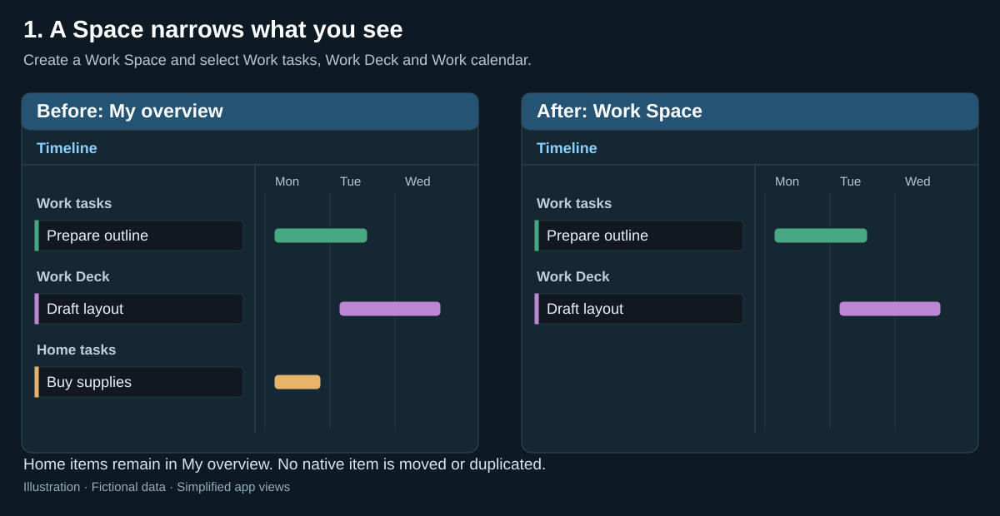
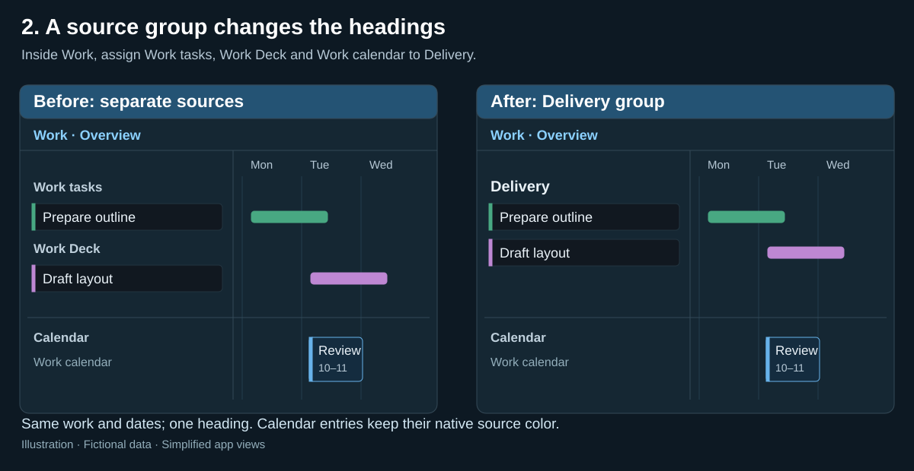
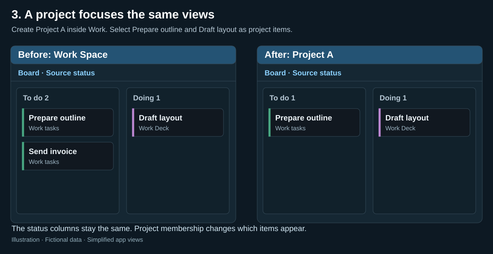

# NextGlance: organize a useful view

The three illustrations below use fictional data. They show the effect of your choices, rather than every button in the interface.

## Start with My overview

Connect your Nextcloud account through **Settings & connection**. On Android, **Continue with Nextcloud Files** uses an account from the installed Nextcloud app; browser sign-in is also available.

**My overview** combines accessible work from your sources. Its filters still apply: check source visibility, Deck assignments and **Show completed and cancelled** if something seems missing. Creating a Space never changes My overview’s organization.

To group this view, open **My overview → ⋯ → Group sources**. Combine sources or narrow by native tags, just as within a Space. These groups belong only to My overview, sync to your other clients, and leave unmatched items visible. No Space is required.

## 1. Create a Space to choose the sources

Imagine you have Work tasks, Work Deck, Work calendar and Home tasks. Open navigation, choose **+ beside Spaces**, name the Space **Work**, and select the three Work sources.

Now select **Work** in navigation. Timeline shows work from those sources; Calendar shows their dates and bookings; Board shows their tasks and cards. Home tasks remain accessible in My overview. Nothing is copied or moved in Nextcloud.

Use the **three-dot menu beside Work** for source assignments, grouping, Space management or **Delete Space**. Deleting a Space removes its organization, not its Nextcloud items. Another Space can reuse these same sources with a different organization.

## 2. Add a source group to bring related sources together

Within Work, open **Group sources**, create **Delivery**, and assign Work tasks, Work Deck and Work calendar to it. Suggested groups are optional starting points.

In Work’s Timeline and Overview, the related work now sits together under Delivery. Select Delivery in navigation to focus the other views on its sources too. Each item keeps its original source color, native status and permissions.

A group belongs to this Space. Changing Delivery does not regroup My overview or a different Space. **Narrow by tags** can include only tagged items from those sources. Groups are separate from Board status columns.

## 3. Create a project for a particular outcome

Choose **Add project** from Work’s menu. Name it **Project A**, select its sources, then choose its native project tag under **Narrow by tags**. The matching-item count previews the selection.

A project can include whole sources, tag-matched items, and individual items added from their details. For example, Project A and Project B can use the same Deck board with different tags: each shows only its matching items, including future ones. Multiple selected tags mean **any** matching tag within the selected sources. Projects stay inside their Space and may sit within a group.

Switch between Overview, Calendar, Timeline, Board and List while Project A remains selected. **Map statuses** customizes the owning Space; **Use default** restores inheritance. Each page remembers its own search and filters. **Filters → Unified statuses** limits that page without changing native statuses.

## Plan, link and adjust

Open an item to edit its dates. **Schedule in calendar** creates a linked booking with an editable title, linked-work description, location and reminders (15 minutes before by default). **Link existing event** connects one already there. A work deadline and a booking are separate: changing one does not automatically move the other.

Open an event for **Edit event**, reminders, location and guests. On your own calendar, invitations use Nextcloud’s native delivery; received invitations offer Accept, Tentative or Decline. **Delete event** asks for confirmation and keeps linked work. Restricted operations explain why; recurring or delegated events open in Nextcloud.

**Waits for** means prerequisites; **Needed by** means dependent work. Dependency choices use the current Space’s sources. Board’s **Group linked tasks** shows these tasks around their Deck card, without changing status columns. Done Deck cards remain visible; archived cards stay hidden. **Show completed/cancelled tasks** controls finished tasks, while completed tasks directly linked to a visible Deck card remain visible. Attach notes through **Attachments → Attach**.

Inside a Deck card’s **Dependencies**, **Link task** connects a task, **Create task** makes a new native task, and **From checklist** previews its checkbox rows for conversion. Tasks and cards share the same incoming/outgoing columns. Choose a task list and the rows you want. Existing matches are reused; retries keep the same task identity. Checking a task and checking the original card checklist remain separate actions. Enable **Group linked tasks** on Board to see the stack.

Use **Jump to** beside a linked task or event to reveal it in the current date view. From Board or List, choose Calendar or Timeline. If filters or the Space hide it, the app explains what needs adjusting.

Drag a row or card’s body to rearrange it within its group or column; a short click opens the item. On touch, hold before dragging: the Board card floats under your finger, and the destination highlights before you release. Focused rows/cards support Alt + Up/Down. Dragging Timeline bars still edits dates. Moving between Board columns follows the native status rules; reordering within a column leaves status unchanged.

Spaces, groups, projects, status maps, custom order and each page's saved filters sync through Nextcloud, including My overview. Open pages, dates, scroll positions and panel sizes stay on each device. For a slow Android refresh: **Settings & connection → Performance diagnostics → Start recording**, reproduce it, then **Stop recording → Copy log** or **Save log**. The report contains timings and counts, not item content.

Tap the cloud icon to check source and planner sync, including retryable warnings. Sign-in, conflicts and unsaved-edit problems still show an actionable message.
