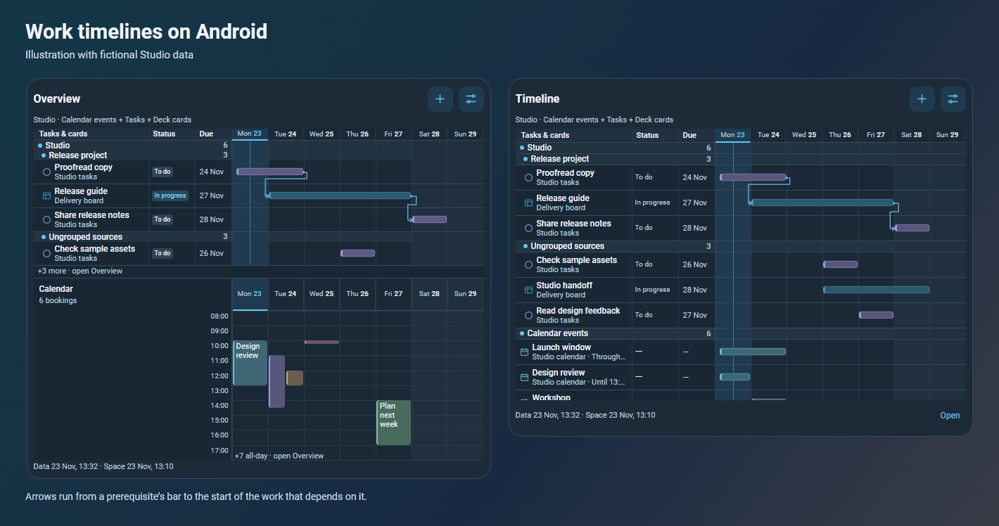

# Android widget examples

Give each widget its own name, page, Space, sources and filters. For example, keep a calendar-only widget beside a Board widget that combines Tasks and Deck.

The Overview and Timeline illustration uses the 0.6.27 layout geometry with fictional Studio data. The launcher’s size and system text settings determine the final appearance and visible rows. [Open the full-size illustration](images/widgets/work-timelines.png).

| Example | Settings to try |
| --- | --- |
| **Calendar · Today** | Page: Calendar; layout: Today; items: Calendar events. Overlapping bookings share the time grid. |
| **Calendar · Week** | Page: Calendar; layout: Week; select only your calendar sources. All-day items have their own strip. |
| **Overview** | Select Calendar events, Tasks and Deck cards. Dated work sits above the timed calendar on the same dates. |
| **Timeline** | Group by project to keep different projects separate, even when they share a source. The date grid shows bars and arrows from prerequisites to the work waiting on them. |
| **Board** | Enable **Group linked tasks**. A visible Deck card retains eligible prerequisite and follow-up tasks; completed tasks are crossed out. Their status need not match the card. |
| **List** | Select Tasks and group by date for a compact task list, including unscheduled items. |

Add **NextGlance** from your launcher's widget picker, then choose its settings. Use the gear to change that widget; deleting it removes its configuration without deleting your Nextcloud data. **+** opens creation in the app using the widget's allowed destinations. Tap an item for details or **Open** for the normal page and Space. Widget filters do not replace the app's saved page filters.

Adjust transparency to control how much wallpaper shows through. Weekend-day shading follows **Settings & connection → Appearance**. Resize a widget to see more content. Calendar Month shows the selected day’s itinerary when space allows. Tap the widget title to open the planner for small or overlapping schedule blocks.

The [original six-widget design gallery](images/widgets/widget-gallery.png) shows Calendar Today and Week, Overview, Timeline, Board and List from an earlier design. Both illustrations use fixed sample dates and synthesized data projected by the [shared widget core](../packages/core/src/widgets.mjs).

[Setup and limits](../android/README.md#home-widgets) · [Implementation and verification](ANDROID-WIDGET-PLAN.md)
